<!-- datasheet:banner -->
<p align="center">
  <picture>
    <source media="(prefers-color-scheme: dark)" srcset=".github/assets/banner-dark.svg">
    
  </picture>
</p>
<!-- /datasheet:banner -->

# Grab

**Paste a link and the right engine takes it. If none can, a headless browser watches the page play.**

A batch downloader for videos, image posts and files, with a command-line tool, a browser GUI, a native Mac app and a stream-catching browser extension. It does the jobs of Video DownloadHelper, JDownloader and image-downloader extensions.

| What you paste | What handles it |
|---|---|
| YouTube videos, playlists, channels; Vimeo, Twitch VODs, TikTok, Twitter/X and Reddit videos, ~1800 sites | **yt-dlp** |
| Raw stream links: `.m3u8` (HLS), `.mpd` (DASH), ISM, RTMP | **yt-dlp + ffmpeg** (fragments fetched 8 at a time) |
| Image posts and galleries: Reddit, Twitter/X, Instagram, Imgur, Pixiv, DeviantArt, Flickr, Tumblr, boorus… | **gallery-dl** (automatic fallback when there's no video) |
| Direct files: zip, iso, pdf, images, model files… | **aria2c** (16 connections per file; drops to 1 if the server refuses) |
| Pages that only show video through JavaScript, embedded players, Threads posts, Google Drive, Dropbox and pixeldrain links | **Grab's page extractor**, with a headless Chromium-family browser as the last resort |

How it gets speed:
- Several downloads run at once (default 4, up to 32).
- Playlists and channels are split into separate jobs, so their videos also download in parallel.
- HLS/DASH fragments are fetched in parallel.
- Direct files use aria2c with up to 16 connections each.

<!-- datasheet:figure -->
## At a glance

<p align="center">
  <picture>
    <source media="(prefers-color-scheme: dark)" srcset=".github/assets/diagram-dark.svg">
    
  </picture>
</p>

| Characteristic | Detail |
| --- | --- |
| **Video** | YouTube playlists and channels, Vimeo, Twitch VODs, TikTok, X and Reddit video, about 1800 sites via yt-dlp |
| **Streams** | `.m3u8` (HLS), `.mpd` (DASH), ISM and RTMP via yt-dlp and ffmpeg, fragments fetched 8 at a time |
| **Images** | Reddit, X, Instagram, Imgur, Pixiv, DeviantArt, Flickr, Tumblr and boorus via gallery-dl |
| **Files** | Direct files via aria2c, 16 connections per file (drops to 1 if the server refuses) |
| **Last resort** | A page extractor and a headless Chromium-family browser for pages yt-dlp and gallery-dl don't know; DRM streams are refused |
| **Interfaces** | CLI, local browser GUI on `127.0.0.1:8765`, native Mac app, Windows 11 PowerShell setup and the Stream Catcher browser extension |
<!-- /datasheet:figure -->

## Quick start

macOS / Linux:

```bash
./setup.sh                                        # ffmpeg, aria2, deno, uv, a .venv and the grab command
grab "https://www.youtube.com/watch?v=VIDEO_ID"  # one video; playlists, galleries and files work the same way
grab --gui                                        # or the browser GUI; ./build_app.sh --install builds the Mac app
```

Windows 11 (PowerShell):

```powershell
.\setup.ps1                                       # winget (ffmpeg, aria2, deno, uv) + .venv + grab.cmd / grab-gui.cmd
grab "https://www.youtube.com/watch?v=VIDEO_ID"
.\Grab` GUI.ps1                                   # or: grab --gui
```

## Typical application

```bash
# 1. A list of links overnight, eight at a time, inside a quiet window
grab -f links.txt -j 8 --window 01:00-07:00

# 2. A podcast or channel as MP3, kept up to date
grab watch add https://example.com/podcast.rss --format mp3 --every 6

# 3. A talk as audio, just the part you want
grab -a --audio-format mp3 --clip 12:00-48:30 "https://www.youtube.com/watch?v=VIDEO_ID"
```

## Setup

```bash
./setup.sh
```

The script installs ffmpeg, aria2, deno (YouTube needs a JS runtime) and uv through Homebrew. It then creates `.venv` and links `grab` and `grab-gui` into `~/.local/bin`. **Re-run it whenever a site stops working**: sites change often, and yt-dlp and gallery-dl usually ship fixes within days.

## Mac app

```bash
./build_app.sh --install
```

This builds **Grab.app**, a native window with a Dock icon, and copies it to `~/Applications`, so Spotlight and Launchpad find it.

**Adding downloads**
- **Presets:** one click picks the format: Best video, 1080p, 720p, MP3 or M4A audio, Images, or Direct file. Everything else is under *More options*.
- **Copied links:** when you switch to Grab after copying a link, a banner offers to download it.
- **Paste and download:** ⇧⌘V downloads whatever links are on your clipboard.
- **Open the download folder:** ⌘O.
- **Send to Grab:** drag the button from Settings (⌘,) to your browser's bookmarks bar. Clicking it on any page downloads that page straight away. The button carries Grab's private key; links without it (e.g. made by some website) only show a banner for you to confirm. If you added the button before this change, re-add it to get instant downloads.

**Managing downloads**
- **Rich list:** each download shows a thumbnail, duration, uploader and size. Playlists are grouped, with each video's progress underneath.
- **Pause and resume:** pause any download (or all of them) and resume it later from where it stopped.
- **History:** your download list is kept after you quit. Unfinished downloads come back paused, ready to resume. Prefer a clean slate? Turn off *Remember finished and failed downloads between launches* in Settings → General, and only downloads still waiting come back.
- **Queue order:** a waiting download has *Move to the front of the line* and *Move to the back of the line* buttons, so a link you need now doesn't sit behind a long batch. The list follows the real order.
- **Export and import links:** *Export links* (above the list) saves the links in the tab you're looking at (All, Active, Done or Failed) as `grab-links-<view>-<time>.txt` in your download folder and shows it in Finder: one link per line, ready for `grab -f file.txt`. *Import…* (next to Analyze) puts the links from one or more text files into the box; dragging a file onto the window does the same. *Export links* on the Failed tab is the quickest way to retry a batch on another day.
- **Find and filter:** search with ⌘F, and filter by All, Active, Done or Failed.
- **Clear the list:** *Clear all* takes every finished and failed download off the list and out of the history. *Clear finished* (shown when there are failed ones too) keeps the failed ones so you can retry them. Your files always stay in the folder.
- **Per-download actions:** Open, Show in Finder, Copy link, Retry or Remove.
- **Errors:** each failure gets a one-line reason and a tip. *Details* shows the full log, and *Copy details* copies everything needed to see why it failed: Grab and yt-dlp versions, the link, your options, where the login came from, the error and the log. It never copies login cookies. Failed downloads keep their log after Grab restarts.
- **Log file:** Grab writes what each download did, and why any failed, to `~/Library/Application Support/Grab/logs/grab.log` (at most 3 MB). Settings → Engine → *Show log file*.

**Working in the background**
- **Notifications:** you get one when downloads finish while you're in another app.
- **Dock badge:** the Dock icon shows how many downloads are active.
- **Menu bar:** a download icon in the menu bar shows "2 · 45%" while busy. Its menu lists current downloads with time left, plus *Paste Link and Download*, *Pause/Resume All*, *Open Grab* and *Quit*. If you use a menu-bar manager (Vorssaint, Bartender…), it may hide the icon behind « at first.
- **Closing vs. quitting:** closing the window turns Grab into a menu-bar-only app (no Dock icon) that keeps downloading, notifying and checking watched sources. Quit from the menu-bar icon. Quitting asks first if downloads are still running.

The app runs its own copy of the engine in `~/Library/Application Support/Grab/runtime`, so it never needs access to your Documents folder. Your history and settings live there too. `./setup.sh` keeps that copy updated. After editing the code in `grab/`, run `./build_app.sh --update-runtime`.

## Browser GUI

Double-click **`Grab GUI.command`**, or run `grab-gui`. It opens `http://127.0.0.1:8765` in your browser. The server only listens on your own machine.

Paste links (one per line, or drop a `.txt` file) and press **Download** (⌘↵). Each job shows live progress, speed and ETA, plus Cancel, Retry and Show in Finder buttons.

## CLI

```bash
grab URL [URL ...]                    # anything: video, playlist, post, file
grab -f links.txt -j 8                # batch from a file, 8 at a time
grab -a URL                           # audio only (m4a; --audio-format mp3)
grab -q 1080 --subs URL               # cap at 1080p, embed subtitles
grab --clip 1:20-2:45 URL             # just that part
grab --original URL                   # keep AV1/VP9 (smaller), skip the compatibility conversion
grab -i 1-20 https://youtube.com/@channel/videos   # first 20 videos of a channel
grab -c chrome https://x.com/user/media            # use your logged-in Chrome cookies
grab -m images https://reddit.com/r/wallpapers/top # force gallery-dl
grab -r https://site.com/page "https://cdn.site.com/master.m3u8"   # raw stream that needs a Referer
grab --help
```

Every option:

| Option | Meaning |
|---|---|
| `-f, --file FILE` | a text file with one link per line (`-` reads stdin) |
| `-o, --out DIR` | output folder (default `~/Downloads/grab`) |
| `--flat` | save everything directly in the output folder, no per-site subfolders |
| `-j, --jobs N` | downloads at the same time (default 4) |
| `-m, --mode auto\|video\|audio\|images\|direct` | `auto` tries video, then images, then a direct file |
| `-a, --audio`, `--audio-format m4a\|mp3\|opus\|flac\|wav` | audio only, and which format |
| `-q, --quality best\|2160\|1440\|1080\|720\|480\|360` | cap the video height |
| `--container mp4\|mkv\|webm` | the output container |
| `--subs`, `--sub-langs en,es` | embed English subtitles, or the languages you name (`all` for every language) |
| `--clip FROM-TO` | only that part, e.g. `1:20-2:45`, or `90-` for "to the end" |
| `--original` | keep AV1/VP9 instead of converting to compatible H.264/HEVC |
| `--no-sponsorblock` | don't cut YouTube sponsor segments |
| `-c, --cookies BROWSER`, `--cookies-file FILE` | use a browser's logins, or a Netscape `cookies.txt` |
| `-r, --referer URL`, `-H, --header "Name: value"` | send a Referer or extra headers (repeatable) |
| `--fragments N`, `--conns N` | HLS/DASH fragments in parallel (default 8), aria2c connections per file (default 16) |
| `--no-aria2`, `--aria2-streams` | don't use aria2c, or use it for plain-HTTP video streams too |
| `--limit-rate`, `--total-limit`, `--window HH:MM-HH:MM` | a cap per download, a cap for all together, and a time window (see Schedule and speed limits) |
| `--no-archive`, `--no-smart`, `--no-expand` | re-download things you already have, switch off the auto-fix, keep playlists inside one job |
| `-i, --items 1-20` | only these playlist or gallery items |
| `--gui`, `--doctor`, `--update`, `--nightly`, `--version` | open the browser GUI, check the install, update the engines (nightly builds), print the version |

Files go to `~/Downloads/grab/<Site>/…` (change it with `-o`). Things you've already downloaded are skipped, tracked in `.grab-archive.txt` and `.grab-gallery.sqlite3`; `--no-archive` turns that off. Interrupted direct downloads resume.

## Pages Grab doesn't know

When yt-dlp and gallery-dl both say "Unsupported URL", and the link isn't a plain file, Grab doesn't give up:

1. **The page extractor** reads the page: video and audio tags, embedded players, linked files, Threads posts, and share links for Google Drive, Dropbox and pixeldrain (turned into direct downloads).
2. **A headless browser** (any Chromium-family browser installed in the usual place: Brave, Chrome, Chromium, Edge, Vivaldi or Helium) opens the page, lets its JavaScript run, presses play, and watches what the page loads: HLS and DASH playlists, video files and the finished page. Two of these browsers run at most at the same time.

Whatever it finds is downloaded like any other link. Set `GRAB_NO_HEADLESS=1` to switch the browser step off; the page extractor still runs.

Encrypted streams (DRM) are recognised and refused with a clear message: Grab does not decrypt them.

## Quality, Analyze, clips and extras

- **Best quality, compatible format (default):** Grab picks the highest resolution available. At 1080p and below that's H.264, so no conversion. When a site only offers higher resolutions as AV1/VP9 (YouTube at 1440p/4K/8K), Grab converts to **HEVC MP4** with the Mac's hardware encoder. HDR, audio, chapters, subtitles and the cover image are kept, and the result plays everywhere on Apple devices and in DaVinci Resolve. Turn it off under *More options → Video format → Original* (CLI: `--original`) for smaller AV1/VP9 files.
- **Analyze:** paste one link and press **Analyze** to see every quality with its codec and estimated size, which ones get converted, and audio-only options. You can also set a clip range, subtitles, sponsor removal, chapters and cover image just for that link.
- **Only part of a video:** *More options → Only part* (or in Analyze), e.g. `1:20` to `2:45`, or a start with no end. Grab downloads only that section, cut exactly. On the command line: `grab --clip 1:20-2:45 URL`.
- **YouTube extras** (defaults under *More options*):
  - **Sponsor segments:** cut sponsor segments, self-promotion and "subscribe" reminders (SponsorBlock).
  - **Chapters and cover image:** keep chapters, and embed the thumbnail as cover art.
  - **Subtitles:** embed subtitles (English, or all languages).
- **Polite mode** (Settings → Speed, on by default): Instagram, X, TikTok, Facebook, Reddit and Threads download **one at a time per site**, with a random 4–12 s gap and short pauses between requests, so a logged-in account isn't flagged for automated activity. Other sites still download in parallel.

## Whole profiles and the watch list

**Download a whole profile, subreddit or channel.** Paste the link like any other. For Instagram, Reddit users and subreddits, X, Bluesky, Tumblr, Pinterest, Flickr and similar sites, Grab uses gallery-dl, which gets every post's photos and videos. YouTube and TikTok channels go through yt-dlp, which splits them into parallel downloads.
- **Photos or videos only:** set *More options → From profiles & galleries, get…*.
- **Only the latest posts:** use *Only items*, e.g. `1-50`.

**Watch it for new posts.** Open the **Watching** tab, or press *Watch for new posts instead* when you paste a profile:
- **How often:** every hour, every few hours, daily or weekly.
- **First check:** *only new posts from now on* (what exists today is skipped), *the latest 10*, or *everything*.
- **Per source:** format (e.g. a podcast or music channel as MP3) and photos/videos.
- **What you see:** each source shows when it was last checked, what came in and when the next check is. Downloads are tagged with the source they came from.
- **Ties into your schedule:** checks use the download window and speed limit.
- **Tidy list:** each check looks at the newest ~30 posts, then removes its "already had" rows, so your list only shows new downloads.

Instagram and X only show profiles to logged-in users, and Reddit may block logged-out access from some networks. When that happens, the source or download says **Needs you logged in** and shows buttons for the browsers on your Mac: *Use Chrome · Use Safari · Use Firefox · Use Zen · Use Brave*. Click the one where you're logged in to that site. Grab retries with that browser's login and remembers it as the default.
- **Chrome/Brave:** macOS asks once for permission to read the browser's logins (a Keychain prompt). Choose *Always Allow*.
- **Safari:** Grab needs Full Disk Access (System Settings → Privacy & Security). Grab tells you if that's missing.
- **Zen:** supported, because it stores its data like Firefox. Helium can't be read.
- **Reddit:** it often blocks VPN addresses even when you're logged in. If you use one, try with it off.

From the command line (these use the app's list when Grab is open):

```bash
grab watch add https://www.youtube.com/@NASA --every 6
grab watch add https://bsky.app/profile/nasa.gov --latest 10 --videos
grab watch add https://example.com/podcast.rss --format mp3 --all
grab watch add https://bsky.app/profile/nasa.gov --photos --only-new --cookies chrome --name "NASA photos"
grab watch list
grab watch run
grab watch remove "@NASA (YouTube)"
```

`--photos` and `--videos` limit what is fetched, `--only-new` (the default) skips what exists today, `--cookies BROWSER` takes that site's login from a browser, and `--name` labels the source.

`grab watch run` checks everything now. Add `--due` to check only the sources whose time has come, which is handy for a scheduled job.

## Stream Catcher browser extension

Use this for sites with no download button and that yt-dlp doesn't know. It does what Video DownloadHelper does: while a page plays, it watches for the video and audio streams (HLS `.m3u8`, DASH `.mpd`, MP4, WebM, MP3…). The toolbar icon shows how many it found. One click sends a stream to Grab, together with the page it played on (many sites refuse the stream without it) and the page title, which becomes the file name. Files go into that page's site folder.

**Install** in Chrome, Brave, Helium, Edge, or another Chromium browser:
1. Open `chrome://extensions` (Brave: `brave://extensions`) and turn on **Developer mode**.
2. Click **Load unpacked** and choose the extension folder. In Grab: Settings → **Show extension folder** (`~/Library/Application Support/Grab/browser-extension`), then drag it onto the dialog. Or use `browser-extension/` in this project.
3. Pin **Grab Stream Catcher** to the toolbar.

**Use it** (with Grab running, clicking Download starts straight away; if Grab is closed, it opens and starts too):
- **Popup:** play the video, then click the icon. You get "Download this page" plus the list of found streams, with resolution and length. If Grab knows the site (YouTube, Reddit, X…), the popup says so, and downloading the page is the better choice there.
- **Right-click:** on any video, link, image or page, choose **Download … with Grab**.
- **A video that plays but isn't listed?** The popup lists what a page plays: HLS/DASH playlists and video files, including signed CDN links that have no file extension and files named like `part1.mp4`. It keeps a short note of everything else that looked like media and was left out. Click **Not seeing your video? Show everything else the page loaded** to see each one with the reason (for example *under 400 KB: usually a preview*), and Copy or Download it yourself. Pieces of a stream (hundreds of `.ts` or `.m4s` bits) are only counted, because none works alone: use the stream in the list, or *Download this page*. Grab names an extension-less download after the page and gives it the right ending (`.mp4`, `.webm`, `.mp3`…) by looking inside the file.
- **Keyboard shortcut:** **Option+Shift+G** (Alt+Shift+G elsewhere) does what *Download this page* does, without opening the popup. The icon shows ✓ when Grab has it. Change the keys at `chrome://extensions/shortcuts` (Brave: `brave://extensions/shortcuts`).
- **If Grab isn't running,** the extension opens it through a `grab://` link and the stream appears in a banner.

**Everything on page:** the button next to *Download this page* lists every picture and video on the page as thumbnails, for any site.
- **What it finds:** pictures (the biggest version a page offers, and the full-size picture when a thumbnail links to one), pictures that only load when you scroll, CSS backgrounds, videos, and links to picture or video files, in every frame of the page.
- **Filters:** All, Pictures or Videos, and a minimum size (200 px by default, so icons and avatars stay out). Everything starts ticked; click a tile to untick it, or use *Select all* and *None*.
- **Download N** sends them to Grab as one group in the list, *"N files from <page title>"*. They're saved in `<site>/<page title>/` under their own names. Two files with the same name become `image.jpg` and `image (2).jpg`, and links with no extension (X's pictures) get one.

**Auto-download:** turn on *Auto-download videos on <site>* in the popup (or *On every site*), and every video that site plays goes to Grab by itself. Nothing to click.
- **Video pages on sites Grab knows**, such as a YouTube video or Short, an Instagram post or reel, an X post, a Reddit post, TikTok, Facebook, Vimeo, Dailymotion or a Twitch clip: as soon as the page starts playing, Grab gets the page link. That gives the best quality and the real title. A playlist (`&list=`) or start time in the link is dropped, so it's just that video.
- **Other pages**, including feeds like X's home timeline: each stream the page loads goes to Grab, named after the page.
- **Each video goes once:** the extension remembers what it sent, even when a site re-signs the link on every visit, and Grab skips anything it already has. Reloading a page doesn't download it again.
- **What it leaves alone:** DRM streams, live streams, audio-only tracks, ads, hover previews, clips under 4 s and the separate quality and audio parts of a stream. No more than 15 videos are sent from one page, so a page cycling previews can't flood Grab.
- **Grab not running:** videos wait in the extension (up to 50, for 12 hours) and go when Grab is back. No window pops up.
- **Off by default.** Channels, profiles and feed pages on YouTube aren't video pages, so browsing them downloads nothing.

**What it skips on purpose:**
- **Stream pieces:** individual `.ts` and `.m4s` pieces of a stream are left out.
- **Previews and ads:** hover previews and ad videos are ignored.
- **YouTube's internal streams:** Grab downloads YouTube from the page link instead, with better quality and title.
- **DRM-protected streams** (Netflix, Prime, Disney+…) are shown greyed out, because they can't be downloaded.

**Security:** Grab only accepts downloads from this extension's fixed ID. Browsers stamp that ID on its requests and web pages can't fake it, so websites can't add downloads.

## Schedule and speed limits

Set these in **Settings → Schedule & speed**:
- **Total speed limit:** one cap for all downloads together, e.g. 2 MB/s. It works across parallel downloads, multi-connection files and HLS fragments, and changes take effect immediately, even mid-download. You can apply it only at certain hours, such as limiting during the day and running at full speed at night.
- **Download window:** e.g. only download between 01:00 and 07:00. Links you add outside the window show as **Scheduled**. Optionally, running downloads pause when the window closes and resume when it reopens. **Start now**, or *Start right away* next to Download, skips the wait.
- **Keep the Mac awake:** prevents idle sleep while there are downloads to do, so night downloads don't stall. The Mac must be on and Grab open. With the lid closed on battery, macOS still sleeps.

The header shows the active limit ("Limited to 2 MB/s") and how many downloads are waiting.

From the command line:

```bash
grab -f links.txt --total-limit 3M
grab -f links.txt --window 01:00-07:00
```

The second command waits until 01:00, then downloads.

How the total cap works: yt-dlp's own `--limit-rate` is per connection, so 8 parallel fragments would get 8× the limit. Instead, Grab routes downloads through a small local speed governor on 127.0.0.1 that meters everything with one shared budget.

## Staying up to date

Sites change often, and yt-dlp and gallery-dl ship fixes within days, so Grab updates them by itself:
- **Schedule:** the app and the browser GUI check PyPI at launch and every 6 hours.
- **Safe install:** a new version installs only while nothing is downloading. Grab then restarts its engine in a second or two. Waiting downloads continue, and you see an "Updated yt-dlp to …" notice.
- **Errors trigger it:** errors that usually mean yt-dlp is out of date ("Unable to extract…", "please report this issue", signature errors) start a check right away. Those downloads are retried once the update is in.
- **Settings → Updates:** shows your versions and when Grab last checked. You can switch to the **Nightly** channel for yt-dlp's newest fixes, or turn automatic updates off.
- **Command line:** `grab --update` (add `--nightly` for nightly builds). `./setup.sh` does the same for the command line and the app together. The Homebrew tools (ffmpeg, aria2, deno) update with `brew upgrade`.

## Troubleshooting

### Checking that it works

**Quick health check.** This confirms the tools are installed, the versions are current, the download folder is writable with enough space, and YouTube works right now. It's also in the app under Settings → Engine → **Run self-check**.

```bash
grab --doctor
```

**Test suite.** The offline tests use a local test website made on the fly with ffmpeg, so they need no internet. They cover:
- **Download paths:** progressive MP4, HLS streams, MP3 audio, direct files with and without aria2c, parallel batches, and skipping things already downloaded.
- **Errors:** 404s and pages with no video.
- **Auto-fix:** strategy switching, and remembering what worked.
- **Pause, resume and cancel:** pause then resume, with a byte-for-byte check of the resumed file; also cancelling.
- **History:** that it survives a restart.
- **GUI server:** its API, including that other websites can't control it.

```bash
.venv/bin/python -m pytest
```

The suite also covers the page extractor, the download queue order and the GUI page (`test_extract.py`, `test_queue.py`, `test_ui.py`), and tests the browser extension end to end: a headless Helium/Chromium loads it, plays a test page, and the test checks what it detects, its popup, and that Grab downloads what it sends. It also checks auto-download: off by default, waiting while Grab is closed, and never downloading the same video twice. It needs Node and a Chromium browser.

Add `--online` to also test real sites: a YouTube video, a channel split into parallel jobs, YouTube audio, a Flickr gallery, the update server, and the extension on a real third-party video player.

```bash
.venv/bin/python -m pytest --online
```

If an online test fails, the site has probably changed. Run `grab --update` and try again.

### When something fails

- **"login required" / "blocked" / "Unavailable"** (Reddit, X, Instagram, age-restricted YouTube): choose your browser under *Use login cookies from* (CLI: `-c chrome`). You must be logged in to the site in that browser. Safari cookies need Full Disk Access for Terminal.
- **"Unsupported URL" on some random site:** Grab already tried its page extractor and a headless browser (see "Pages Grab doesn't know"; they need a Chromium-family browser). If the video still isn't found, open the page and play the video. In DevTools > Network, filter `m3u8`, `mpd` or `mp4` and copy the request URL. Paste that URL, with the page URL as Referer. This is what Video DownloadHelper does under the hood.
- **429 / Too Many Requests:** lower parallel downloads and retry later.
- **DRM streams** (Netflix, Prime Video, Disney+, Spotify…) are not supported.

Only download content you have the right to download.

### Auto-fix: switching strategies on errors

When a download fails, Grab reads the error and retries with a strategy that fits it:

| Error | What Grab tries, in order |
|---|---|
| Rate limit (429), 403, timeouts, dropped connections | fewer connections (2 fragments, small chunks, slower requests) → another YouTube player (YouTube only) → switch between the built-in downloader and aria2c → simpler format |
| Merge or format errors | simpler single-file format → another YouTube player |
| Direct files | 16 connections → 1 connection → plain HTTP |
| Image galleries hitting rate limits | slower requests with pauses between them |
| Login required, or page not found | no retries; you get a tip instead |

Whatever worked is remembered per site and used first next time. If it stops working there, Grab goes back to normal settings. Downloads that needed a fix show an **auto-fixed** badge. Settings lists what Grab has learned and lets you forget it. You can turn this off under *More options → Auto-fix failed downloads*, or with `--no-smart` on the command line.

## Absolute maximum ratings

| Parameter | Limit |
|---|---|
| Parallel downloads | 4 by default, up to 32 |
| aria2c connections per file | 16, dropping to 1 if the server refuses |
| HLS/DASH fragments in parallel | 8 by default |
| Headless browsers at once | 2 |
| Polite mode (Instagram, X, TikTok, Facebook, Reddit, Threads) | one download at a time per site, with a random 4 to 12 s gap |
| Engine update check | at launch and every 6 hours |
| DRM streams decrypted | 0 |

## Errata

* DRM-protected streams (Netflix, Prime Video, Disney+, Spotify and the like) are not supported: Grab recognises them and says so, but does not try to decrypt them.
* Instagram and X show profiles only to logged-in users, and Reddit may block logged-out access from some networks; see "Needs you logged in".
* Helium's logins cannot be read; Zen's can. Safari needs Full Disk Access.
* The headless-browser step needs a Chromium-family browser installed in the usual place (an app in `/Applications` on macOS).

## License

MIT. See [LICENSE](LICENSE).

<!-- datasheet:footer -->
---

<p align="center">
  <a href="https://github.com/S-k404/odysseus-speech-tools">&larr; U7 odysseus-speech-tools</a> &middot;
  <a href="https://github.com/S-k404/S-k404">SK-404 index</a> &middot;
  <a href="https://github.com/S-k404/flight-live">U11 flight-live &rarr;</a>
</p>
<!-- /datasheet:footer -->
